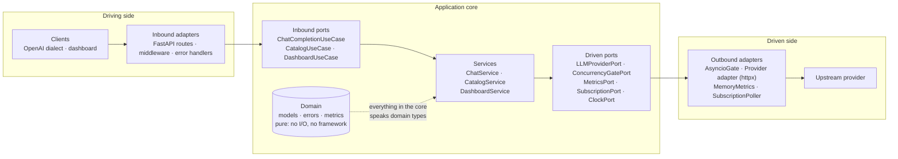
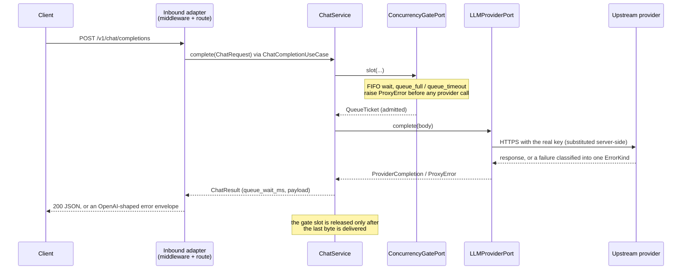

# Architecture

Hexagonal architecture (ports and adapters): the core never touches HTTP or the
provider directly. Everything crosses a port.

Ports are `typing.Protocol` contracts in `application/ports/`; the services and
adapters are constructed with them as keyword arguments. `main.py` is the single
[composition root](../src/inference_provider_proxy/main.py): the only place that
knows both the ports and the concrete adapters.

## Traffic flow

Streaming follows the same path through `stream()`; the slot stays held until
the chunk iterator finishes or is closed.

## Rules

| Layer                | May depend on           | Must never depend on                     |
| -------------------- | ----------------------- | ---------------------------------------- |
| `domain/`            | standard library only   | anything above it, any framework         |
| `application/`       | `domain`                | FastAPI, httpx, adapters                 |
| `adapters/inbound/`  | `application`, `domain` | `adapters/outbound/`                     |
| `adapters/outbound/` | `application`, `domain` | `adapters/inbound/`                      |
| `main.py`            | everything              | nothing (it is the one place allowed to) |

1. **Layering**: dependencies point inward only: `adapters → application → domain`.
2. **Domain purity**: no `fastapi`, `starlette`, `httpx`, `pydantic` or `uvicorn` inside `domain/`.
3. **Inbound never reaches outbound**: routes see ports, never concrete adapters.
4. **No import cycles** at module level.

All four are enforced by [`qa/architecture/test_hexagon.py`](../qa/architecture/test_hexagon.py),
each with a companion test proving it fails when deliberately violated.
